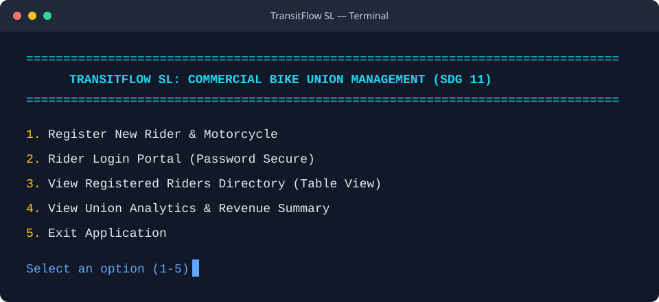

# TransitFlow SL - Commercial Bike Union Management System (SDG 11)

## Overview, insights & Primary Purpose
**TransitFlow SL** is an enterprise-grade, console-based software application engineered to digitize, secure, and streamline commercial motorcycle (**Okada**) union management across Freetown, Sierra Leone. 

### Primary Purpose:
In major African urban centers like Freetown, commercial motorbikes form the backbone of everyday commuter transport. However, informal union operations struggle with paper-based rider tracking, unverified driver identities, unaccountable cash fee collections, and poor safety compliance auditing. 

**TransitFlow SL addresses these real-world challenges by providing:**
1. **A Centralized Digital Registry:** Authenticates rider identities, driver's licenses, and motorcycle plate numbers.
2. **Password-Protected Rider Self-Service:** Allows riders to securely log into their personal portal to verify compliance and execute direct digital payments.
3. **Transparent Financial Management:** Automates levy, safety fine, and permit collections while providing real-time financial statements and audit logs.
4. **Data-Driven Executive Auditing:** Empowers union executives to view station analytics, inspect safety pass rates, and track total fleet revenue.

This system represents **Stage 1 (Dart Console Architecture)** of a 3-stage software engineering project for Limkokwing University, serving as the foundational logic layer for **Stage 2 (Flutter Mobile UI)** and **Stage 3 (Supabase Relational Database Integration)**.

## Application Screenshot

The TransitFlow SL console opens to this main menu:



---

## Sustainable Development Goals (SDG Alignment)
* **SDG 11: Sustainable Cities and Communities (Target 11.2):** Enhances urban mobility, safety, and transport governance by enforcing motorcycle safety inspections, tracking rider station zones, and establishing organized union registries.
* **SDG 8: Decent Work and Economic Growth:** Provides transparent, accountable financial ledger management for informal transport workers, union executives, and municipal authorities.

---

## Core System Functionalities
1. **Rider & Vehicle Registration:**
   * Registers bike riders with complete identity credentials (Full Name, Phone Number, Driver's License Number, Assigned Station Zone, and Secure Portal Password).
   * Binds unique motorcycle plate numbers and vehicle models directly to registered rider accounts.

2. **Password-Secure Rider Portal & Self-Service Dashboard:**
   * Password-authenticated login system preventing unauthorized account access.
   * Real-time query of rider safety compliance status, inspection passes, and personal profile details.
   * **Direct In-App Gateway:** Allows riders to process instant payments for Daily Levies (Le 25,000), Safety Fines (Le 15,000), Annual Permits (Le 100,000), or custom amounts directly within the terminal interface.
   * Detailed payment ledger and audit trail displaying itemized transaction timestamps.

3. **Formatted ASCII Directory & Executive Analytics:**
   * **Tabular Directory View:** Displays all registered riders and motorbikes in a clean, professional ASCII table with column borders (`| ID | FULL NAME | PHONE NUMBER | ZONE STATION | BIKE PLATE | DUES PAID |`).
   * **Executive Summary:** Calculates real-time total revenue generated across all registered vehicles and audits safety inspection compliance metrics across stations.

4. **Dynamic Terminal UI & Architectural Cleanliness:**
   * Custom terminal column detection (`stdout.terminalColumns`) for responsive header dividers and full-screen terminal resets.
   * Strict modular 6-folder architecture (Models, Views, Controllers, Services, Database, and Configuration).

---

## System Architecture & Directory Structure

```text
SOFT_ENG_PROJECT/
├── LICENSE                    # Professional MIT License Agreement
├── README.md                  # Detailed Project Documentation
├── index.dart                 # Application Bootstrap Entry Point
├── config/
│   └── theme.dart             # Terminal Theme Settings & Dynamic ANSI Color Constants
├── controllers/
│   └── union_controller.dart  # Business Controller Handling Validation & Auth Routing
├── database/
│   └── app_database.dart      # In-Memory Relational Mock Database Storage
├── models/
│   ├── bike.dart              # Motorcycle Fleet Entity Model
│   ├── daily_log.dart         # Financial Transaction & Audit Log Model
│   └── rider.dart             # Bike Rider Profile Data Model (with Password Security)
├── services/
│   └── rider_service.dart     # Service Layer Executing Core Business & Payment Logic
└── views/
    ├── rider_dashboard.dart    # Interactive Dashboard View for Individual Riders
    └── terminal_ui.dart       # Primary Executive Terminal & ASCII Table View Interface
```

---

## Terminal Documentation

**Project location:** `C:\Users\Administrator\OneDrive\Desktop\SOFT_ENG_PROJECT`
**Active file:** `index.dart`
**Entry point:** `void main()` initializes `RiderService` and `TerminalUI`, then calls `terminalUI.start()`

**Visible files in workspace root:**
- `config/` — terminal theme settings & dynamic ANSI color constants
- `controllers/` — business controller handling validation & auth routing
- `database/` — in-memory relational mock database storage
- `index.dart` — application bootstrap entry point
- `License.md` — project license
- `models/` — bike.dart, daily_log.dart, rider.dart
- `Readme.md` — project documentation
- `services/` — rider service layer executing core business & payment logic
- `views/` — rider_dashboard.dart, terminal_ui.dart

**index.dart contents:**
```dart
import 'services/rider_service.dart';
import 'views/terminal_ui.dart';

void main() {
  RiderService riderService = RiderService();
  TerminalUI terminalUI = TerminalUI(riderService);
  terminalUI.start();
}
```# TRANSITFLOW-SL_BSEM-SEMS3_GROUP9_SE
